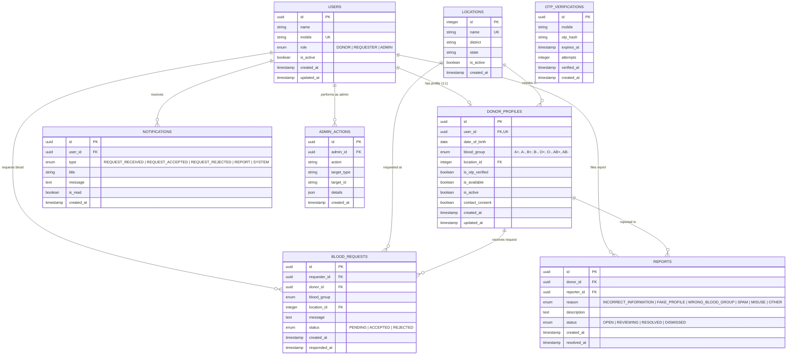

<p align="center">
  
</p>

# Blood Connect — System Architecture & Data Layer
**Connecting Donors. Reaching Those in Need.**

## 1. Overview & Purpose

**Blood Connect** is a donor discovery and connection platform. It connects registered, OTP-verified blood donors with requesters based primarily on **blood group** and **predefined location**.

> [!IMPORTANT]
> **Not a Blood Bank**: Blood Connect does not store, collect, transport, or test blood. All medical suitability, donor eligibility, and actual donation procedures remain strictly between the donor, requester, and the hospital/doctor.

---

## 2. Technology Stack & Design Decisions

| Layer | Technology | Decision Rationale |
|---|---|---|
| **Backend Framework** | **FastAPI** (Python 3.12) | Asynchronous REST API, high performance, automatic OpenAPI documentation, dependency injection. |
| **ORM & Database Layer** | **SQLAlchemy 2.0** + **asyncpg** / **aiosqlite** | Modern typed declarative models (`Mapped[]`, `mapped_column()`), native async execution, strong relationship mapping with `lazy="selectin"`. |
| **Migrations** | **Alembic** | Version-controlled, reproducible database schema management with async support. |
| **Validation & Settings** | **Pydantic v2** & **pydantic-settings** | Fast, type-safe schema definitions and environment configuration loading. |
| **Primary Keys** | **UUIDv4 (`uuid.UUID`)** | Privacy-preserving, non-enumerable, collision-free identifiers for user identities, donor profiles, requests, and reports. |

---

## 3. Entity Relationship Diagram (ERD)



---

## 4. Database Schema Details & Indexing Strategy

### 4.1 Tables & Constraints

1. **`users`**:
   - `id`: Primary key (UUID)
   - `mobile`: Unique constraint, indexed for fast authentication lookups.
   - `role`: Indexed enum (`DONOR`, `REQUESTER`, `ADMIN`).
   - `is_active`: Indexed boolean for filtering active accounts.

2. **`donor_profiles`**:
   - `user_id`: Unique foreign key to `users.id` (`ON DELETE CASCADE`).
   - `location_id`: Foreign key to `locations.id` (`ON DELETE RESTRICT` prevents accidental deletion of active locations).
   - **Composite Search Index** (`ix_donors_search_composite`):
     - Index on `(blood_group, location_id, is_available, is_active, is_otp_verified)` ensures lightning-fast queries when requesters search for available donors matching specific criteria.

3. **`locations`**:
   - Predefined locations: `Coimbatore`, `Sulur`, `Tiruppur`, `Pollachi`, `Mettupalayam`, `Avinashi`, `Palladam`, `Udumalpet`, `Annur`, `Madukkarai`, `Perur`.
   - `name`: Unique constraint and indexed.

4. **`otp_verifications`**:
   - `mobile`: Indexed for quick OTP lookup.
   - `created_at` & `expires_at`: Indexed for cleanup and rate-limiting / resend throttling.
   - Compound index `ix_otp_mobile_created_at` on `(mobile, created_at)` for instant rate limit checks.

5. **`blood_requests`**:
   - `requester_id` & `donor_id`: Indexed foreign keys with cascade on delete.
   - `status`: Indexed enum (`PENDING`, `ACCEPTED`, `REJECTED`).
   - `created_at`: Indexed for chronological dashboard feeds.

6. **`reports`**:
   - Indexed on `donor_id`, `reporter_id`, `status`, and `created_at`.

7. **`admin_actions`**:
   - Audit trail storing `admin_id` (`ON DELETE SET NULL` to preserve logs even if an admin user is removed), `action`, `target_type`, `target_id`, and `details` JSON.

8. **`notifications`**:
   - Indexed on `user_id`, `is_read`, and `created_at`.

---

## 5. Security & Privacy Guarantees

* **Phone Number Concealment**:
  - Donors' mobile numbers are never exposed in search results.
  - The search endpoint projects donor data strictly via safe DTOs (e.g. `PublicDonorResponse` containing name, blood group, location name, availability status).
* **Requester Contact Access**:
  - Requester phone number is only made accessible to the donor **after** the donor explicitly marks the request as `ACCEPTED`.
* **OTP Protection**:
  - OTP values are hashed server-side using secure hashing before persisting.
  - Plaintext OTPs are never stored in the database or written to log files.
  - Maximum 3 verification attempts per OTP with 5-minute expiry window and 60-second resend cooldown.

---

## 6. Directory Layout

```text
BloodConnect/
├── backend/
│   ├── alembic/
│   │   ├── versions/
│   │   │   └── 20260914_0001_initial_schema.py
│   │   ├── env.py
│   │   └── script.py.mako
│   ├── app/
│   │   ├── api/
│   │   │   └── v1/
│   │   │       ├── health.py
│   │   │       └── router.py
│   │   ├── core/
│   │   │   ├── config.py
│   │   │   └── security.py
│   │   ├── database/
│   │   │   ├── base.py
│   │   │   └── session.py
│   │   ├── models/
│   │   │   ├── admin_action.py
│   │   │   ├── blood_request.py
│   │   │   ├── donor.py
│   │   │   ├── enums.py
│   │   │   ├── location.py
│   │   │   ├── notification.py
│   │   │   ├── otp.py
│   │   │   ├── report.py
│   │   │   └── user.py
│   │   ├── schemas/
│   │   │   ├── common.py
│   │   │   └── health.py
│   │   ├── seeds/
│   │   │   └── locations.py
│   │   └── main.py
│   ├── tests/
│   │   ├── conftest.py
│   │   ├── test_health.py
│   │   └── test_models.py
│   ├── alembic.ini
│   ├── requirements.txt
│   ├── .env.example
│   └── .env
├── ARCHITECTURE.md
├── README.md
└── .gitignore
```
